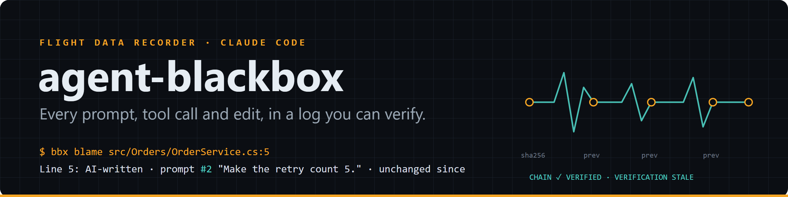
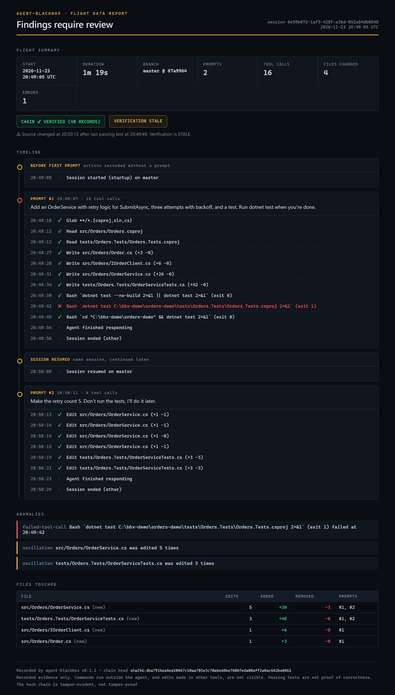
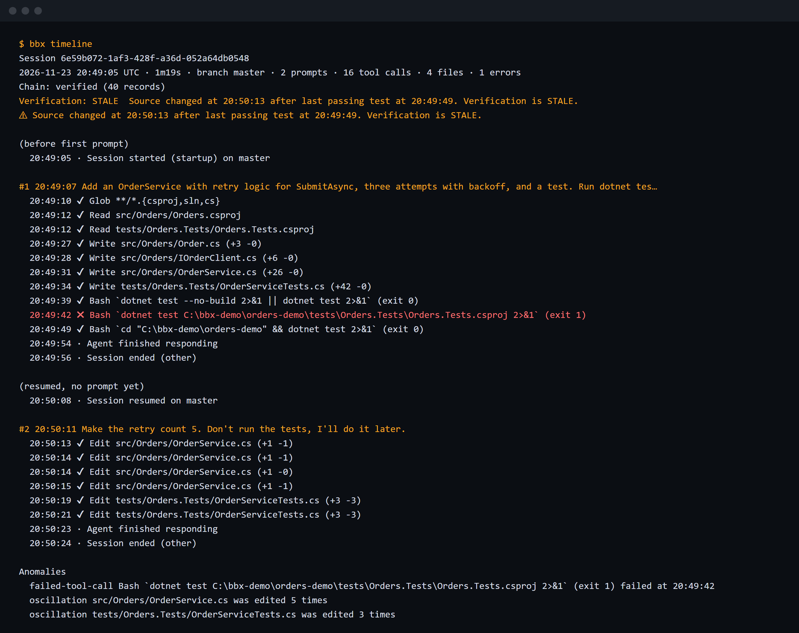
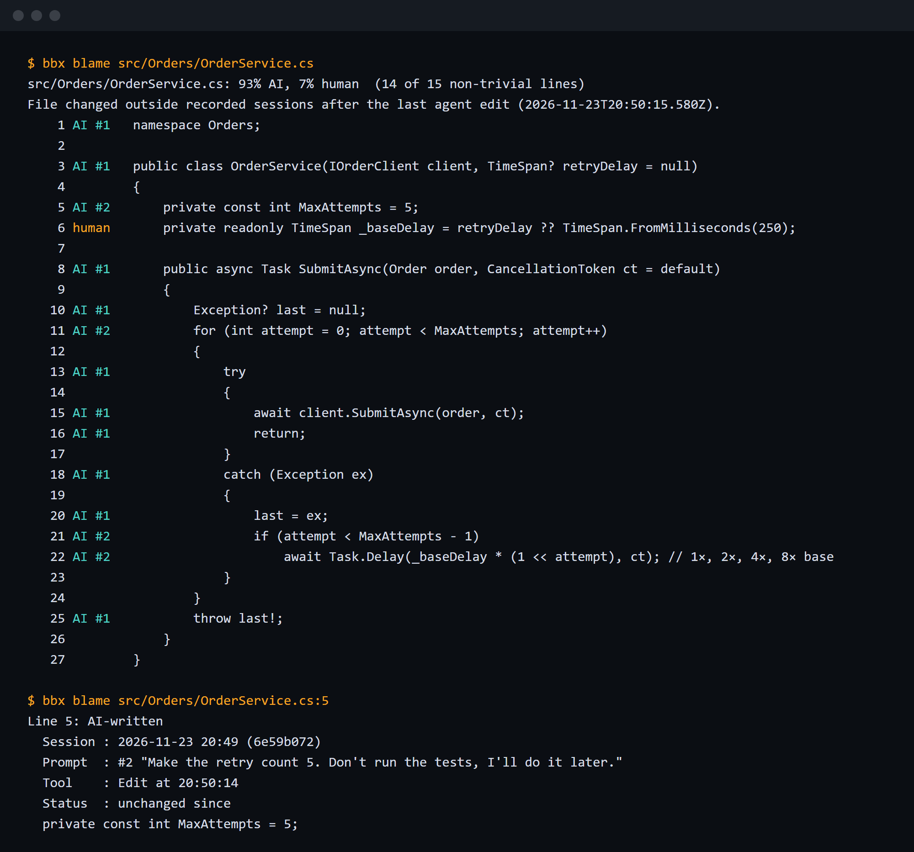
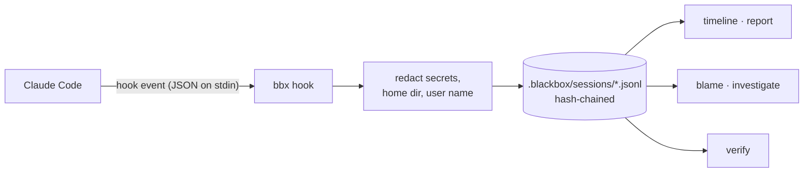

<p align="center">
  
</p>

<p align="center">
  <a href="https://www.nuget.org/packages/AgentBlackbox"></a>
  <a href="https://www.nuget.org/packages/AgentBlackbox"></a>
  <a href="https://github.com/sayinbrahim/agent-blackbox/actions/workflows/ci.yml"></a>
  
  
  <a href="LICENSE"></a>
</p>

`bbx` records what Claude Code does in your repository into a hash-chained log you can verify. When something breaks, it writes the incident report. It can also tell you, line by line, whether code came from the agent, from which session and from which prompt.

<p align="center">
  
  <br>
  <sub>A real two-prompt Claude Code session in a demo project. The second prompt said not to run the tests, so the report marks the session STALE.</sub>
</p>

## Why

I used to write avionics software under DO-178C. In that world no line of code goes without an owner: each one traces to a requirement, a test and a record. When an aircraft goes down, the flight recorder tells you what happened, second by second.

Agents now write a large share of our code, and none of it leaves a record. Nobody can say why the agent touched a file, which prompt caused a regression, or which lines a person actually wrote. `bbx` is my attempt to bring the flight recorder over. Aviation is where the idea comes from, nothing more: this tool makes no certification claims.

## Quick start

```
dotnet tool install -g AgentBlackbox    # needs the .NET 10 SDK; or grab a binary from Releases
bbx init                                # in your project: creates .blackbox/ and adds Claude Code hooks
                                        # Codex, Cursor or Copilot CLI: bbx init --agent codex|cursor|copilot
```

Then use Claude Code as usual. When you want to look:

```
bbx timeline          # what happened in the latest session
bbx report            # HTML incident report
bbx blame src/Orders/OrderService.cs:5
```

With the .NET 10 SDK you can also run it without installing: `dnx AgentBlackbox -- timeline`.

## What you get

**`bbx timeline`** groups every action under the prompt that caused it, and flags failures, files the agent kept rewriting, and tests that went stale.



**`bbx blame`** answers "who wrote this line?" for a whole file or a single line: the session, the prompt and the tool call.



<sub>Same demo session. Line 6 was edited outside the agent afterwards, so it counts as human.</sub>

## What it records

One JSONL file per session in `.blackbox/sessions/`. Each line holds the hook event, a semantic `kind` (`PromptSubmitted`, `FileModified`, `TestCompleted`, ...), the actor, the prompt that led to it, and the event data:

- For a file edit it keeps the repo-relative path, the diff (up to 16 KB), how many lines were added and removed, normalized hashes of the added lines, and SHA-256 hashes of the file before and after. It never stores the whole file.
- For a command it keeps the command, its exit code and the last 1 KB of output, and it notes when the command was a test run or a build.
- For a prompt it keeps the full text by default. Set `record_prompts` to `hash` or `off` if you'd rather it didn't. Background task notifications are recorded separately and never count as prompts.

### Privacy

Nothing leaves your machine. Before `bbx` writes a record, it redacts API keys, GitHub tokens, JWTs, private keys, passwords in connection strings and `.env` lines, credentials in URLs, and your own home directory and user name. Files that match `ignore_paths` (`.env*`, `**/secrets/**`, `*.pem`, `*.pfx`, `appsettings.*.json` by default) are recorded as "changed", with no diff and no hashes.

`.blackbox/` is committed by default, so the team shares the provenance. Use `bbx init --private` to keep it out of git. Redaction works by pattern matching and can miss things. See [docs/SECURITY.md](docs/SECURITY.md).

## Commands

| Command | What it does |
|---|---|
| `bbx init [--local] [--private] [--guard] [--agent <name>]` | Creates `.blackbox/` and merges hooks into `.claude/settings.json` (`--local`: `settings.local.json` with this binary's absolute path). Keeps existing settings, backs them up first, and does nothing the second time. `--guard` also installs the pre-flight guard. `--agent codex\|cursor\|copilot` writes that agent's hook config instead (experimental, see below). |
| `bbx init --uninstall` | Removes the bbx hooks. Leaves `.blackbox/` alone. |
| `bbx verify` | Recomputes every hash chain and checks the chain heads anchored in git commits. Exit code 1 if a record was edited, deleted or reordered, or a log no longer matches its anchor. |
| `bbx anchor [--install-hook [--local]]` | Prints `Blackbox-Head` trailers for the staged session logs, or installs the git hook that adds them to every commit. |
| `bbx sessions` | Lists sessions with duration, prompts, tool calls, files, chain status and verification state. |
| `bbx timeline [session]` | Prompts and the actions they led to, with failures and warnings. Honors `NO_COLOR`. |
| `bbx blame <file>[:line] [--json]` | AI/human split for a file, or the session, prompt and tool behind a single line. `--json` lists the AI-written lines for editors. |
| `bbx report [session] [--format html\|md] [-o file]` | Single-file HTML incident report (no scripts, works offline), or Markdown for a PR description. |
| `bbx investigate --commit <sha>` | The recorded sessions behind a commit, with the prompts, the build and test evidence at commit time, and any changed files that no session explains. |
| `bbx check [--require-trace <regex>] [--require-tests] [--base <ref>]` | CI gate for AI-written code. Exit code 1 when a rule fails or a session log fails chain verification. See below. |
| `bbx hook <event> [--agent <name>]` | Called by the agent. Always exits 0 and never prints, so the recorder can't break the agent. |
| `bbx guard [--agent <name>]` | Called by the agent before a tool runs, when the guard is installed. Exit code 2 blocks the call and tells the agent why. Any error allows the call. |

`session` is an id prefix and defaults to the latest session.

### `bbx check` in CI

`bbx check` looks at the lines `bbx blame` attributes to the agent and holds them to two optional rules:

- `--require-trace "REQ-\d+"`: each AI line has to come from a session whose prompts, up to that edit, mention a requirement ID. Failures read "Untraced AI code: 3 files (no requirement link)". If prompts are stored as hashes, the check says so instead of guessing.
- `--require-tests`: each session that changed source with AI code has to have run a test command or changed a test file.

The rules apply to source files; docs (`*.md`, `docs/**`) are listed but not judged. `--base origin/main` limits the check to lines added since the branch left `main`, which is what you want on a pull request:

The GitHub Action downloads the native binary (no .NET needed), checks only what a pull request adds, and puts the result in the job summary:

```yaml
- uses: actions/checkout@v4
- uses: sayinbrahim/agent-blackbox@v0.3.0
  with:
    require-trace: "REQ-\d+"
    require-tests: "true"
```

Inputs: `require-trace`, `require-tests`, `base` (defaults to the pull request's base branch), `version`, `bbx-path` and `working-directory`. It runs on Linux, macOS and Windows runners. Without the action, install the tool and run the same command:

```yaml
- uses: actions/checkout@v4
  with:
    fetch-depth: 0            # --base needs history
- uses: actions/setup-dotnet@v4
  with:
    dotnet-version: 10.0.x
- run: dotnet tool install -g AgentBlackbox
- run: bbx check --base origin/${{ github.base_ref }} --require-trace "REQ-\d+" --require-tests
```

The check can only see what was recorded. Code from a session nobody recorded counts as human, so pair it with `.blackbox/` committed in the repository.

### Other agents (experimental)

Claude Code is the agent bbx was built and tested with. Codex CLI, Cursor and GitHub Copilot CLI have hook systems too, and `bbx init --agent <name>` writes bbx into theirs:

| Agent | `--agent` | Config written | Notes |
|---|---|---|---|
| Codex CLI | `codex` | `.codex/hooks.json` | Run `/hooks` in Codex and trust the bbx hooks; Codex skips untrusted hooks. Edits arrive as `apply_patch` and are recorded per file. |
| Cursor | `cursor` | `.cursor/hooks.json` | Edits come from `afterFileEdit`, commands from `afterShellExecution`. |
| Copilot CLI | `copilot` | `.github/hooks/agent-blackbox.json` | Also picked up by the Copilot cloud agent, which honors only the bash command. |

A small adapter turns each agent's payload into the shape bbx records, so `timeline`, `blame`, `report`, `check`, `verify` and `--guard` work the same way. What an agent doesn't report stays unknown: Cursor gives no exit code for shell commands, so a test run there shows as "result not recorded" and the session stays UNVERIFIED instead of passing. Codex and Copilot exit codes are read from the command output when it contains one.

These adapters follow each agent's published hook documentation (November 2026). Unlike the Claude Code path, they have not been run against a real session yet. If you use one of these agents, a session log and an issue are very welcome.

### VS Code

The extension in [vscode/](vscode/) puts an amber bar in the gutter next to every AI-written line. Hover the line to see the session, prompt and tool behind it, and the status bar shows the file's AI share. It calls `bbx blame --json`, so it needs bbx 0.3.0 or later on PATH (or `agentBlackbox.bbxPath`). Until it is on the Marketplace, install the `.vsix` with `code --install-extension agent-blackbox-<version>.vsix`.

### Pre-flight guard

Recording tells you what went wrong afterwards. The guard stops a few things before they happen. It is opt-in: `bbx init --guard` adds a `PreToolUse` hook that checks Bash, PowerShell and file-edit calls, and blocks the call when a rule matches. The agent is told which rule matched and why, and the block shows up in `bbx timeline` and the report.

Default rules:

| Rule | Blocks |
|---|---|
| `force-push` | `git push --force`, `-f` and `+branch` refspecs. `--force-with-lease` is allowed. |
| `drop-database` | `dotnet ef database drop` |
| `delete-migrations` | `rm`, `del`, `Remove-Item` or `git rm` on anything under a `Migrations/` folder |
| `protect-recordings` | Edits to, or deletion of, `.blackbox/sessions/` |

Turn defaults off and add your own in `.blackbox/config.json`. `command` is a regex on the command line (text inside quotes is ignored), `edit` and `delete` take globs:

```json
"guard": {
  "disable": ["drop-database"],
  "rules": [
    { "id": "no-env", "edit": [".env*", "**/secrets/**"], "reason": "Secrets stay with humans." },
    { "id": "no-hard-reset", "command": "git\\s+reset\\s+--hard" }
  ]
}
```

The guard is a seatbelt against accidents, not a security boundary. It reads the command line as written: a script, `bash -c "..."`, a variable or a `cd` it doesn't follow gets past it. A broken rule or a crash allows the call and goes to `.blackbox/errors.log`, so a bad config never stops the agent.

### Verification freshness

`bbx` notices when the agent runs tests or builds, and tracks whether source files changed afterwards:

| State | Meaning |
|---|---|
| `VERIFIED` | Tests passed after the last source change. The tests passed. That doesn't mean the code is correct. |
| `STALE` | Source changed after the last passing test run. |
| `FAILED` | The last test run failed. |
| `UNVERIFIED` | No test run recorded. |

Only commands the agent runs through its own tools are visible. Tests you run in another terminal are not.

## How it works



Claude Code starts `bbx hook <event>` for each session start, prompt, tool call and session end. `bbx` turns the payload into a record, redacts it, and appends it under a file lock:

```
record[n].hash = SHA256( record[n].prev + "\n" + canonical_json(record[n] without hash) )
record[n].prev = record[n-1].hash            record[0].prev = "sha256:GENESIS"
```

The chain is **tamper-evident, not tamper-proof**. It catches a record that was edited, deleted or moved. Anyone with write access can still regenerate the whole chain.

Anchoring makes that harder. `bbx anchor --install-hook` adds a git `prepare-commit-msg` hook: when a commit includes session logs, it writes the head of each staged log into the message as a trailer, `Blackbox-Head: <session> <seq> sha256:<hash>`. `bbx verify` then checks every anchored head in the history of `HEAD`. A log rewritten after the commit fails, even if its own chain is consistent. This only protects what was pushed before the rewrite, and history itself can be rewritten too, so it is a stronger audit trail, not proof. The hook never blocks a commit, and it leaves an existing `prepare-commit-msg` hook alone (it prints the line to add instead).

`bbx blame` matches whitespace-normalized line hashes from recorded agent edits of the same file. A line the agent wrote and nobody changed is found even if it moved within the file. A line edited afterwards counts as human. Files the agent never touched while recording count as human or unrecorded. Edits the agent makes through the shell (`sed`, a script) are not file edits to the hooks, so those lines count as human too.

## Performance

Claude Code starts a new process for every hook, so startup time is what counts. `bbx` is compiled with Native AOT and ships as a single 5 MB executable. Time per hook call, from starting the process to its exit, with the payload piped in:

| Machine | Median | p95 |
|---|---|---|
| Windows 10 desktop (author's machine), 100 runs | 16.4 ms | 18 to 25 ms |
| GitHub-hosted Linux runner, 50 runs | 7.8 ms | 9.7 ms |
| GitHub-hosted Windows runner, 50 runs | 24 ms | 26.7 ms |
| GitHub-hosted macOS runner, 50 runs | 51 ms | 90 ms |

The same build without AOT takes 181 ms on the Windows desktop. macOS runners are slow to start processes, and their numbers vary from run to run. Measure your own machine with `pwsh scripts/bench-hook.ps1 -Bbx <path-to-bbx>`.

## It recorded its own creation

`bbx` was installed in this repository as soon as recording worked (Milestone 1), and everything after that is in [.blackbox/](.blackbox/). The first recorded session covers the rest of Milestone 1 and Milestone 2: 8 prompts, 140 tool calls, 25 files changed, 297 chained records. Its [flight report](docs/flight-reports/c30ed484.md) ([HTML](docs/flight-reports/c30ed484.html)) shows a STALE warning: the last source change came after the last test run. [`investigate-c6d0b85.md`](docs/flight-reports/investigate-c6d0b85.md) traces a real commit. Two files match recorded edits exactly. The third matches none, because it was edited with `sed` rather than through the agent's edit tool.

## Roadmap

v0.2 brings `bbx check`, its GitHub Action and chain-head anchoring in commit trailers (all described above).

v0.3 is about prevention and reach: the pre-flight guard, the VS Code extension and experimental adapters for Codex CLI, Cursor and Copilot CLI (all described above).

## Build from source

```
dotnet build
dotnet test
dotnet publish src/Blackbox.Cli -c Release -r win-x64
```

Native AOT needs the platform C/C++ toolchain (on Windows: Visual Studio Build Tools with "Desktop development with C++"). Release steps are in [docs/RELEASING.md](docs/RELEASING.md).

## Author

Halil İbrahim Sayın: Senior .NET developer, formerly an avionics engineer working under DO-178C. Also wrote [dotnet-context-mcp](https://github.com/sayinbrahim/dotnet-context-mcp) and [ef-migration-safety](https://github.com/sayinbrahim/ef-migration-safety).

## License

MIT
